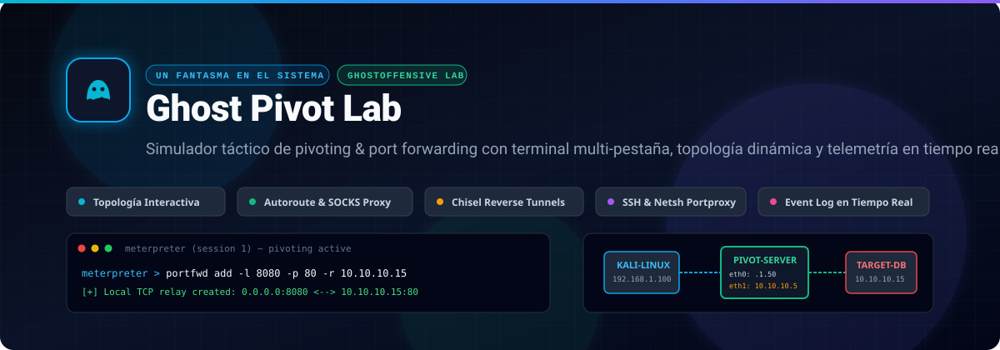
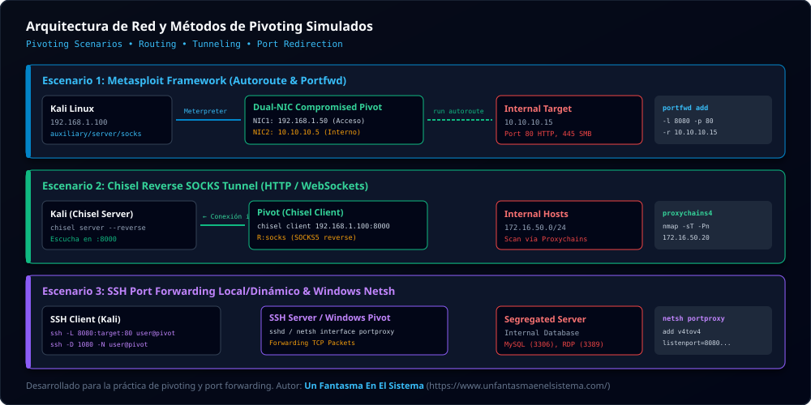

# 🛡️ eJPTv2 Pivoting & Port Forwarding Lab

<p align="center">
  
</p>

<p align="center">
  <a href="https://unfantasmaenelsistema.github.io/ejptv2-pivoting-lab/"></a>
  <a href="https://www.unfantasmaenelsistema.com/"></a>
  
  
  
  
  <a href="LICENSE"></a>
</p>

---

## 🎯 Descripción General

**eJPTv2 Pivoting Lab** es un simulador interactivo de ciberseguridad diseñado específicamente para estudiantes y profesionales que se preparan para el examen de certificación **eJPTv2 (eLearnSecurity Junior Penetration Tester v2 / INE Security)**.

Uno de los mayores desafíos en el examen es dominar el **salto de red (pivoting)**, el **enrutamiento interno (autoroute / SOCKS proxy)** y la **redirección de puertos (port forwarding)** para alcanzar máquinas en subredes privadas que no tienen acceso directo desde la máquina atacante.

Esta aplicación replica fielmente la experiencia táctica con:
- Una **terminal multi-pestaña interactiva** que simula Bash, `msfconsole`, Meterpreter, Chisel y SSH.
- Una **topología de red gráfica y reactiva en tiempo real** que muestra los paquetes, interfaces Dual-NIC, estados de máquinas comprometidas y túneles activos.
- Un **Event Log en tiempo real** que monitoriza y alerta sobre cada hito táctico (sesiones, rutas, túneles y hosts descubiertos).
- Una **guía estructurada paso a paso con barra de progreso** y tips reales de examen.

---

## 📸 Capturas de Pantalla

### 🖥️ Vista General del Laboratorio en Acción
<p align="center">
  
</p>

### 🗺️ Arquitectura de Red y Métodos de Pivoting Simulados
<p align="center">
  
</p>

---

## ⚡ Características Principales

### 1. 🧭 Topología de Red Dinámica y Reactiva
- **Doble tarjeta de red (Dual-NIC)**: Representación visual clara de la máquina Pivot con interfaces en la DMZ (`192.168.1.50`) y en la LAN interna (`10.10.10.5` o `172.16.50.10`).
- **Estados Visuales**: Indicadores de máquinas comprometidas (**PWNED**), puertos abiertos (HTTP 80, SMB 445, MySQL 3306), y túneles de retransmisión activados.
- **Túneles en tiempo real**: Líneas de enrutamiento que se iluminan al ejecutar `autoroute`, `portfwd` o `chisel`.

### 2. 💻 Terminal Multitarea Profesional (Bash / Metasploit / Meterpreter)
- **Multi-Pestaña y Pantalla Dividida (Split View)**: Abre sesiones simultáneas de Bash (Kali), consola de Metasploit (`msfconsole`) y shells Meterpreter para trabajar en paralelo.
- **Persistencia en `localStorage`**: Todos los comandos introducidos se sincronizan automáticamente. Puedes navegar con <kbd>↑</kbd> y <kbd>↓</kbd> en el historial incluso tras recargar la página o cambiar de escenario.
- **Autocompletado Inteligente (<kbd>Tab</kbd>)**: Asistente de comandos contextual para agilizar la práctica.
- **Sintaxis y Flags Reales**: Soporte para comandos auténticos (`portfwd add -l 8080 -p 80 -r 10.10.10.15`, `run autoroute -s ...`, `auxiliary/server/socks_proxy`, `chisel`, `ssh -L`, etc.).

### 3. 📡 Event Log en Tiempo Real
- Componente inferior con telemetría en vivo que registra:
  - 🟢 **Sesiones Establecidas**: Meterpreter, SSH y shells inversas.
  - 🔵 **Rutas Inyectadas**: Subredes agregadas a la tabla de enrutamiento interna.
  - 🟡 **Puertos Redirigidos**: Creación de relays locales y remotos.
  - 🟣 **Descubrimiento de Red**: IPs y MACs detectadas con escaneos ARP/Nmap.
  - 🔴 **Compromiso de Objetivos**: Alertas visuales con efectos táctiles de pwned.
- Filtros por categoría y controles para limpiar eventos.

### 4. 📊 Guía de Escenario con Barra de Progreso
- **Porcentaje de Completitud**: Barra visual animada que calcula el progreso exacto según los objetivos superados.
- **Instrucciones Didácticas**: Objetivos ordenados, comandos recomendados y pistas específicas del examen eJPTv2.

### 5. 📋 Cheatsheet, Bloc de Notas & Reporte de Auditoría
- **Cheatsheet Modal**: Chuleta completa con comandos rápidos para Metasploit, Chisel, SSH, Netsh Windows y Proxychains.
- **Bloc de Notas (Scratchpad)**: Área para apuntar credenciales y flags descubiertos, con autoguardado en `localStorage`.
- **Generador de Informe**: Exportación de resumen de auditoría en formato profesional para entrega de examen.

---

## 🧪 Escenarios de Laboratorio Disponibles

| Escenario | Vector de Ataque | Herramientas Clave | Topología |
|:---|:---|:---|:---|
| **1. Metasploit Pivoting & Autoroute** | Explotación de servicio web público y salto hacia subred privada. | `run autoroute`, `auxiliary/server/socks_proxy`, `portfwd add`, `proxychains4` | `192.168.1.0/24` ➔ `10.10.10.0/24` |
| **2. Chisel Reverse SOCKS Tunnel** | Evasión de firewall perimetral mediante túnel inverso HTTP/WebSockets. | `chisel server --reverse`, `chisel client R:socks`, `socks5://127.0.0.1:1080` | `192.168.1.0/24` ➔ `172.16.50.0/24` |
| **3. SSH Port Forwarding & Netsh** | Túneles SSH locales y dinámicos combinados con `portproxy` de Windows. | `ssh -L`, `ssh -D`, `netsh interface portproxy add v4tov4` | `192.168.1.0/24` ➔ `10.20.30.0/24` |

---

## ⌨️ Tabla de Comandos Más Usados en el Simulador

### Metasploit & Meterpreter
```bash
# Ver información de interfaces y arquitectura
meterpreter > sysinfo
meterpreter > ipconfig

# Añadir ruta hacia la red interna aislada
meterpreter > run autoroute -s 10.10.10.0/24
meterpreter > run autoroute -p

# Redirigir puerto local 8080 hacia el puerto 80 del objetivo interno
meterpreter > portfwd add -l 8080 -p 80 -r 10.10.10.15
meterpreter > portfwd list

# Enviar sesión a segundo plano
meterpreter > background
```

### Chisel Reverse Tunnel
```bash
# En Kali Linux (Atacante)
kali$ chisel server --reverse -p 8000

# En el Pivot (Víctima comprometida)
pivot$ chisel client 192.168.1.100:8000 R:socks

# En Kali Linux vía Proxychains
kali$ proxychains4 nmap -sT -Pn -p 80,445 172.16.50.20
```

### SSH Tunneling & Windows Netsh
```bash
# Redirección de puerto local (Local Port Forwarding)
kali$ ssh -L 8080:10.20.30.50:80 usuario@192.168.1.50

# Túnel Dinámico SOCKS (Dynamic Port Forwarding)
kali$ ssh -D 1080 -N -f usuario@192.168.1.50

# Redirección de puerto nativa en Windows (Cmd Administrador)
C:\> netsh interface portproxy add v4tov4 listenport=8080 listenaddress=0.0.0.0 connectport=80 connectaddress=10.20.30.50
C:\> netsh interface portproxy show all
```

---

## 🚀 Puesta en Marcha (Instalación Local)

### Requisitos Previos
- [Node.js](https://nodejs.org/) v18.0 o superior
- [npm](https://www.npmjs.com/) v9.0 o superior

### Pasos de Instalación

1. **Clonar el repositorio:**
   ```bash
   git clone https://github.com/unfantasmaenelsistema/ejptv2-pivoting-lab.git
   cd ejptv2-pivoting-lab
   ```

2. **Instalar dependencias:**
   ```bash
   npm install
   ```

3. **Iniciar el servidor de desarrollo:**
   ```bash
   npm run dev
   ```
   Abre [http://localhost:3000](http://localhost:3000) en tu navegador para comenzar a practicar.

4. **Compilar para producción:**
   ```bash
   npm run build
   ```
   Los archivos estáticos optimizados se generarán en la carpeta `dist/`.

---

## 📁 Estructura del Proyecto

```text
├── .github/
│   └── workflows/
│       └── ci.yml               # Integración continua (build y lint en GitHub Actions)
├── docs/
│   └── screenshots/
│       ├── banner.svg           # Banner de cabecera en alta resolución
│       ├── app-dashboard.svg    # Mockup completo de la interfaz del simulador
│       └── topology-detail.svg  # Diagrama de topología y vectores eJPTv2
├── public/
│   └── icono.png                # Favicon y logotipo oficial
├── src/
│   ├── components/
│   │   ├── Header.tsx           # Cabecera con logo y enlace a Un Fantasma En El Sistema
│   │   ├── NetworkTopology.tsx  # Lienzo interactivo de topología y subredes
│   │   ├── TerminalHub.tsx      # Terminal multi-pestaña, split screen y parser
│   │   ├── EventLog.tsx         # Telemetría de eventos en tiempo real
│   │   ├── ScenarioGuide.tsx    # Guía paso a paso y barra de progreso
│   │   ├── CheatsheetModal.tsx  # Chuleta rápida con sintaxis de comandos
│   │   ├── Scratchpad.tsx       # Bloc de notas persistente
│   │   └── AuditReportModal.tsx # Generador de informe de examen
│   ├── data/
│   │   └── scenarios.ts         # Datos de los escenarios y máquinas
│   ├── utils/
│   │   └── terminalParser.ts    # Motor de comandos y respuestas tácticas
│   ├── types/
│   │   └── index.ts             # Definiciones TypeScript de datos
│   ├── App.tsx                  # Componente principal y gestor de estado
│   └── main.tsx                 # Entrada React Vite
├── package.json                 # Dependencias y scripts del proyecto
├── tsconfig.json                # Configuración de TypeScript
└── vite.config.ts               # Configuración de compilación Vite
```

---

## 🤝 Contribuciones

Las contribuciones son bienvenidas para expandir este simulador. Puedes consultar la [Guía de Contribución](CONTRIBUTING.md) para proponer nuevos escenarios de examen, comandos adicionales o herramientas como `ligolo-ng`.

---

## 🌐 Autor y Agradecimientos

Creado con pasión para la comunidad de ciberseguridad por **Un Fantasma En El Sistema**.

- 🔗 **Sitio Web Oficial:** [https://www.unfantasmaenelsistema.com/](https://www.unfantasmaenelsistema.com/)
- 📖 **Artículos, Tutoriales y Preparación de Exámenes:** Visita el blog para acceder a guías completas sobre eJPTv2, OSCP y ejercicios prácticos de Red Team.

---

## 📄 Licencia

Este proyecto está bajo la Licencia **MIT**. Consulta el archivo [LICENSE](LICENSE) para más detalles.
